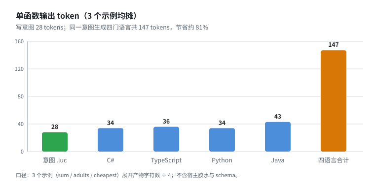
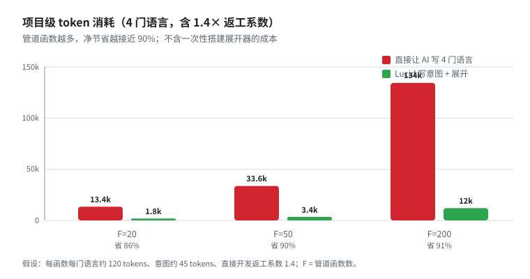

# Lucid

> AI 只写「意图」，机器负责「实现」。语法、类型、效果在展开前拦截，产物逐字节可复现。

Lucid 是一门极小的意图语言：模型只写四类声明（`fn` / `from` / `via` / `yield`），
本地展开器查表生成宿主代码。没有循环、没有 import、没有模板拼贴——**模型没有机会把宿主语言的隐式行为带进来**。
当前注册了 4 个目标：`csharp` / `typescript` / `python` / `java`。

## 为什么

让模型直接写宿主代码，失败通常不在业务逻辑，而在这几处：反复生成样板、调不存在的 API、空值处理每次不同、同一需求两次生成结果不一致。
Lucid 把这些问题从"模型自觉"变成"系统强制"：

| 问题 | Lucid 的做法 |
|---|---|
| 样板代码吃掉 token | 展开器吸收样板，模型只写意图 |
| 幻觉出不存在的算子/API | 表外一律拒绝，报 `E_TYPE_UNKNOWN_OPERATOR` |
| 每次生成都不一样 | 同 AST + 同 schema → 逐字节相同，CI 做两次展开 diff |
| 错误发现太晚 | lex / parse / typecheck / effectcheck 四段拦截，全部在展开前 |

## Token 成本对比

省 token 的主要来源不是「少写几行」，而是「一份意图 → 多门宿主代码」以及把返工挡在展开之前。以下基于仓库内 3 个示例的真实展开产物（字符数 ÷ 4 估算 token，不含宿主胶水与 schema）：



单函数：意图 28 tokens；C# / TypeScript / Python / Java 分别 34 / 36 / 34 / 43，四门合计 147。
即单语言省约 24%，四语言省约 81%。计入直接开发平均 1.3~1.5 轮返工后：



| 管道函数数（4 门语言） | 直接开发 | Lucid | 节省 |
|---|---|---|---|
| 20 | ~13.4k | ~1.8k | 86% |
| 50 | ~33.6k | ~3.4k | 90% |
| 200 | ~134k | ~12k | 91% |

口径与边界：

- 只统计模型输出 token；宿主胶水（`record` / `import` / `main`）和 `schema` 两种方式都要写，不构成节省。
- 搭建展开器本身约 31k tokens 源码（真实对话消耗通常是它的 3~8 倍）；四门语言 + 真实函数规模下，约 250~550 个管道函数回本。
- 单语言、一次性脚本、或逻辑超出 5 个算子的项目，token 收益接近 0 甚至为负；这类场景的价值在确定性与审查成本，而不是 token。

## 快速开始

环境：Node.js ≥ 18。端到端验证另需 .NET SDK ≥ 10、Python 3、JDK ≥ 17；TypeScript 由 `npm install` 装入的 `typescript` 编译校验。

```bash
npm install    # 只装 typescript（devDependency，用于 e2e 编译检查）
npm run ci
```

手动两步：

```bash
node expander/cli.mjs check  examples/sum.luc --schema spec/schema.json
node expander/cli.mjs expand examples/sum.luc --target csharp --schema spec/schema.json
```

`--target` 可取 `csharp` / `typescript` / `python` / `java`，未注册目标报 `E_EXPAND_UNSUPPORTED_TARGET`。

想短一点：`npm link` 之后直接用 `lucid check ...` / `lucid expand ...`。

## 一个完整例子

意图 `examples/adults.luc`：

```lucid
fn AdultCount(users: List<User>) -> Int pure
from users
via filter(age >= 18)
via reduce(count)
yield adults
end
```

同一份意图展开成四种宿主代码：

```csharp
public static int AdultCount(User[] users)
{
    var adults = users.Where(x => x.age >= 18).Count();
    return adults;
}
```

```typescript
export function AdultCount(users: User[]): number {
  const adults = users.filter((x) => x.age >= 18).length;
  return adults;
}
```

```python
def AdultCount(users: List[User]) -> int:
    adults = len([x for x in users if x.age >= 18])
    return adults
```

```java
public static int AdultCount(List<User> users) {
    var adults = (int) users.stream().filter(x -> x.age() >= 18).count();
    return adults;
}
```

各目标的类型映射、宿主职责、可运行样例与运行命令见 [docs/targets.md](docs/targets.md)。

门禁拦下一个幻觉算子：

```json
{"code":"E_TYPE_UNKNOWN_OPERATOR","phase":"typecheck","message":"算子 'flatMap' 未在 operators.yaml 注册（禁止表外算子）","function":"Ages","line":4,"op":"flatMap"}
```

## 目录

| 路径 | 作用 |
|---|---|
| `AGENTS.md` | **AI 入口**：目录地图、硬不变量、任务→改哪里、已知坑 |
| `docs/cheatsheet.md` | 语法与错误码速查 |
| `docs/targets.md` | 目标语言使用手册：类型映射、宿主职责、运行方式 |
| `operators.yaml` | 算子唯一注册表（签名 + 4 门宿主模板） |
| `expander/` | 词法 / 语法 / 检查 / 渲染（render-common + 4 门渲染器）+ CLI |
| `spec/` | 文法、数据源 schema、审查 rubric |
| `prompts/` | 四个角色指令 + 单模型总控 |
| `examples/` | 三个可运行意图 + C#/TypeScript/Python/Java 完整宿主样例 + C++ 形态参照 |
| `tests/` | 门禁正反例、确定性、端到端 |

## 硬不变量

**守住**：分层边界 / 编译期拦截 / 展开确定性 / 纯函数单管道。
**放弃**：表达力（仅 5 个算子）、自动优化、任意多目标（只维护已注册的 4 个目标）。

完整判定表见 [spec/rubric.md](spec/rubric.md)。

## 角色工作流

作者 → 门禁 → 展开 → CI → 审查，四段各有独立目标函数。
单模型时用 [prompts/single-model.md](prompts/single-model.md)，禁止自动连跳——连跳会让审查顺手"修好"问题，独立性失效。

## 状态与限制

- 算子 5 个：`reduce` `filter` `map` `sort` `take`
- 目标语言 4 个：`csharp` / `typescript` / `python` / `java`，每个目标在 CI 里真实编译运行
- `examples/cpp/main.cpp` 是手写参照，**未编译验证**（C++ 尚未注册为正式目标）
- `examples/csharp/Program.cs` 需要 .NET 10+（单文件 `#:property` 指令）
- 7 个反例 fixture，全部按预期错误码打回

## 路线图

- v0.2：`select` / `group` / `join`（需先补类型规则、错误码与测试）
- v0.3：`Result<T,E>` 与失败路径
- 待定：`--target cpp` / `go` / `rust`（需完整工具链与 e2e）

## 贡献

先读 [AGENTS.md](AGENTS.md)。新增算子必须四件套齐全：算子表模板 + 类型规则 + 错误码 + 测试用例。
提交前跑 `npm run ci`，红了不要提 PR。

## 许可

[MIT](LICENSE)
